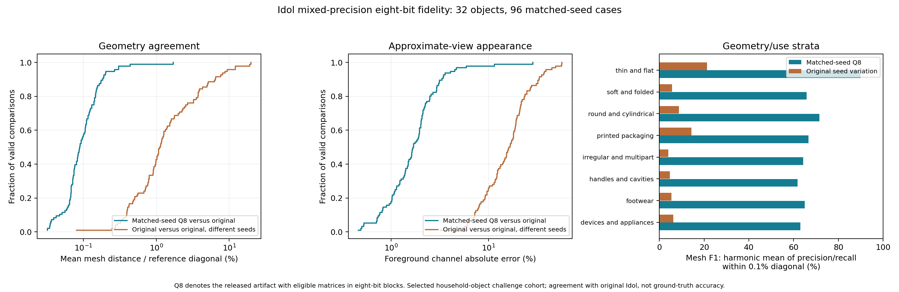

# Idol eight-bit fidelity evaluation

This evaluation measures how closely the released mixed-precision eight-bit Idol
artifact reproduces original Idol on a fixed household-object challenge cohort.
It does not measure reconstruction accuracy against ground-truth three-dimensional
geometry. The candidate was fixed before downloading these inputs; no calibration
or quantization-allocation changes use this cohort.

# Results

Thirty-two selected objects, three matched seeds each: 96 original-versus-Q8 cases. These measure agreement with original Idol, not ground-truth reconstruction accuracy.

| Measure (%) | Valid cases | Mean | Median | Adverse-tail percentile | Worst observed |
|---|---:|---:|---:|---:|---:|
| Mean mesh distance / reference diagonal | 96 | 0.1237 | 0.08917 | 0.2206 | 1.715 |
| Directional 95th-percentile mesh distance / diagonal | 96 | 0.3789 | 0.2596 | 0.7305 | 5.609 |
| Mesh F1 within 0.1% of diagonal | 96 | 68.49 | 71.51 | 34.69 | 5.239 |
| Mesh F1 within 0.5% of diagonal | 96 | 96.74 | 98.92 | 89 | 24.78 |
| Approximate-view foreground color error | 96 | 2.219 | 1.684 | 4.169 | 28.59 |
| Approximate-view silhouette overlap | 96 | 98.63 | 99.38 | 96.5 | 64.7 |
| Relative latent Euclidean error | 96 | 10.73 | 7.647 | 24.74 | 78.24 |

For errors, the adverse tail is the 95th percentile and the worst is the maximum. For scores, the adverse tail is the fifth percentile and the worst is the minimum.

The intervals below resample objects within their declared strata, keeping each object’s seeds together. They describe stability within this selected cohort, not coverage of all objects.

| Measure (%) | Cohort-mean 95% resampling interval | Original seed-variation mean |
|---|---:|---:|
| Mean mesh distance / reference diagonal | 0.09697–0.1584 | 2.48 |
| Directional 95th-percentile mesh distance / diagonal | 0.2898–0.4958 | 7.139 |
| Mesh F1 within 0.1% of diagonal | 64.51–72.14 | 8.835 |
| Mesh F1 within 0.5% of diagonal | 95.06–98.1 | 34.61 |
| Approximate-view foreground color error | 1.708–2.87 | 18.16 |
| Approximate-view silhouette overlap | 97.83–99.18 | 76.69 |
| Relative latent Euclidean error | 8.907–12.77 | 85.52 |

Original-model seed variation changes the stochastic pipeline and is context, not an allowance to subtract from quantization error. Original weights used dense operations; Q8 used fused packed operations.

Recorded failure entries: 0. Generation counts: `{"failed_attempts": 0, "not_attempted_after_session_failure": 0, "successful": 196}`.

## Worst observed mean-distance cases

| Object identifier | Seed | Mean mesh distance / reference diagonal (%) |
|---|---:|---:|
| Lego_Friends_Mia | 2026 | 1.715 |
| DPC_Thinsulate_Isolate_Gloves_Brown | 2026 | 0.4403 |
| HeavyDuty_Flashlight | 0 | 0.3039 |
| Perricone_MD_Cold_Plasma | 0 | 0.3037 |
| Unmellow_Yellow_Tieks_Neon_Patent_Leather_Ballet_Flats | 0 | 0.2692 |
| Threshold_Porcelain_Pitcher_White | 0 | 0.2044 |

### Four-object control results

These four objects were fixed by cohort position. The controls were added during the main run, are conditional and nonadditive, and are excluded from the 96-case headline.

| Object | Fused replay matches main point-cloud bytes | Relative latent difference: fused vs default (%) |
|---|---|---:|
| ASICS_GELLinksmaster_WhiteSilverCarolina_Blue | True | 0 |
| Kanex_MultiSync_Wireless_Keyboard | True | 0 |
| Cole_Hardware_Mug_Classic_Blue | True | 0 |
| TURBOPROP_AIRPLANE_WITH_PILOT | True | 0 |

The replayed fused point clouds matched the original cohort bytes for all four objects. The fused and default paths produced identical latents in these four cases but different point-cloud bytes, so identical latents do not establish identical decoder output. The fixed-preprocessing and fixed-latent interventions are conditional diagnostic comparisons; they do not isolate additive causes. See the [control receipt](../benchmarks/gso32/controls.json).

### Post-hoc worst-case probe

After analysis, the worst case, Lego Friends Mia at seed 2026, was rerun as an exploratory diagnostic. The fused replay matched its saved point-cloud bytes; the default path had the same latent but different cloud bytes. The table uses the same point-to-triangle metric and original reference mesh as the main analysis.

| Intervention | Mean mesh distance / diagonal | Mesh F1 within 0.1% |
|---|---:|---:|
| Fused replay | 1.715% | 5.24% |
| Default kernels | 1.697% | 5.29% |
| Original prepared input, fused pipeline | 1.395% | 5.82% |
| Original latent, eight-bit decoders | 0.0378% | 94.37% |

The original-latent intervention bypasses preprocessing and denoising; it is consistent with a substantial upstream contribution in this one case, but does not assign an additive cause or establish general behavior. Anchor identity is not assumed. The fixed-prepared intervention did not eliminate the discrepancy. These post-hoc results were not used to alter the release candidate and are excluded from the 96-case summary. See the [post-hoc receipt](../benchmarks/gso32/worst-control.json).



[Per-object geometry](../benchmarks/gso32/object-geometry.png) · [Worst-object approximate views](../benchmarks/gso32/worst-case-views.png) · [Worst-object mesh previews](../benchmarks/gso32/worst-case-meshes.png) · [Complete machine-readable results](../benchmarks/gso32/summary.json) · [Run report](../benchmarks/gso32/report.md)


## Cohort and comparison

The cohort contains **32 objects in eight geometry/use strata**, four objects per
stratum: footwear; thin and flat objects; handles and cavities; irregular and
multipart objects; soft and folded objects; devices and appliances; round and
cylindrical objects; and printed packaging. Three seeds, **0, 42 and 2026**, produce
96 matched original-versus-quantized comparisons. The complete protocol was frozen
before inference. It was not registered with a public preregistration service.

Selection used input thumbnails and metadata, before examining model outputs. A
category-balanced draft overrepresented retail boxes and was replaced before any
inference with this explicit challenge cohort. This is a purposive challenge set,
not a random population sample. These inputs were unused in local quantization
development; their overlap with original Idol training is unknown.

Inputs are Google Scanned Objects thumbnails from
[`codepawl/scanned-objects-glb`](https://huggingface.co/datasets/codepawl/scanned-objects-glb)
at revision `fdb214f6ea18996f2d45e05df74c5d9696c3f7a2`. The protocol records each
source path, object identity, original source URL and image digest. Google Research
describes the underlying scans in its [dataset announcement](https://research.google/blog/scanned-objects-by-google-research-a-dataset-of-3d-scanned-common-household-items/).
No source scan is used as an aligned geometric reference in this evaluation.

Every request uses 50 denoising steps, synthetic-image preprocessing and 262,144
Gaussians. Both separate image encoders use unquantized 16-bit brain floating-point
(`bfloat16`) weights, matching the selected upstream SDK precision. Models remain on the
graphics device during each session, with batched guidance and optimized attention.
Only one model is loaded at a time. Original Idol uses dense operations; the
released artifact uses the fused packed runtime. This compares the actual released
pipeline, including background removal, denoising and decoding, rather than a
decoder-only test.

The released file is `Idol-Q8_0.gguf`, 967,253,440 bytes, with Secure Hash Algorithm
256-bit (SHA-256) digest
`1f6875979bac8c8aecacf0c698662b7c63ff54ae1b6d7c06755297a05607e983`.
Original Idol revision is `2731c2291fc65a797c5cb627a5e5526fc1490902`; the upstream
software development kit (SDK) revision is
`4702a7f00850e34b6e83a2170cc123c3e9570744`.

## What is measured

| Surface | Measurement and units | Important limitation |
|---|---|---|
| Mesh geometry | Area-weighted surface samples to closest triangles; unsquared Euclidean distance divided by original mesh bounding-box diagonal, expressed as a percentage | Finite samples can miss small defects; no alignment or rescaling |
| Local geometric agreement | F1, the harmonic mean of precision and recall, within 0.1%, 0.5% and 1% of the original diagonal | A thresholded agreement measure, not an overall accuracy percentage |
| Appearance | Mean absolute red, green and blue channel difference in six fixed orthographic views; channel range 0–1, reported as a percentage | Diagnostic renderer differs from upstream Idol; no target-image comparison |
| Silhouette | Intersection divided by union of pixels with accumulated opacity at least 0.5 | Both-empty views excluded and counted; framing can hide out-of-frame differences |
| Latent | Euclidean norm of the latent difference divided by original latent norm, expressed as a percentage | Internal diagnostic; not directly a perceptual quality score |
| Extracted-mesh topology | Connected components, Euler characteristic, watertightness and surface area | Exploratory; extraction changes topology and self-intersections are unchecked |
| Prepared input and camera | Pixel differences; camera yaw, pitch and vertical field of view in degrees; relative radius difference in percent | Exploratory analyses added during the run |

For geometry, each direction samples 20,000 area-weighted surface points with seed
23. The mean averages the two directional means; the reported 95th-percentile
distance is the larger directional percentile. The maximum is over sampled
points, not a continuous-surface Hausdorff bound. A legacy point-to-point diagnostic
is retained in raw receipts, but the primary comparison uses closest triangles to
avoid target sampling-density error.

Both meshes use the same native extractor: 176 cells per axis over ±0.55 model
units, blur sigma 1.5 voxels, density threshold fraction 0.2 and minimum component
fraction 0.05. The extractor uses opacity-weighted Gaussian centers and omits their
colors, scales and rotations. Smoothing and component filtering can hide defects.
Seed 42 on the first object of each stratum is also measured at resolutions 128
and 224 and with component filtering disabled. These eight sensitivity cases are
fixed by cohort position, not selected by favorable results. The blur remains
1.5 voxels at each resolution, so changing resolution also changes its width in
model units; this is not an isolated test of numerical resolution.

Appearance views have 256 × 256 pixels and a fixed ±0.75 model-unit extent from
both directions of each coordinate axis. The renderer projects Gaussian covariance,
truncates at three standard deviations, adds a half-pixel variance floor and
composites against black. Foreground color uses the union of pixels whose opacity
is at least 1/255 in either render. Views are equally weighted. The accelerated
implementation was compared with the existing diagnostic renderer on a real cloud
fixture and 18 synthetic camera/size cases. This establishes implementation
agreement under those checks, not physical rendering correctness.

## Baselines, uncertainty and failures

All three pairs of original-model seeds are compared within each object, producing
96 contextual seed-variation comparisons. They change the entire stochastic
pipeline. This baseline is not an error allowance and is never subtracted from
quantization error. An original same-seed repeat is also run on four fixed objects
to check repeatability in this environment.

The analysis reports distributions over valid matched cases and means by object
and stratum. Uncertainty intervals use 2,000 stratified resamples of **objects**,
retaining all seeds together. Thus the independent resampling units are 32 objects,
not 96 seeds. These are empirical stability intervals for this selected cohort;
they are not guarantees of population coverage. Failures are reported separately
and never converted into agreement scores. Generation, extraction and derived
comparison failures can refer to the same underlying failure.

No aggregate pass threshold was selected after examining the results. The report
does not declare universal quality acceptance from a favorable mean. Worst-case
figures select the six distinct valid-mesh objects with the largest object-mean
geometry error, displaying each at its worst geometry seed and fixed views.
Paired opaque mesh previews accompany the Gaussian appearance views. Their
orthographic rasterizer is used only for display; no numerical quality measure
uses those preview pixels.

## Exploratory controls

After the main cohort, four objects fixed by protocol positions 0, 4, 8 and 12 are
tested at seed 42 with the same released artifact. These controls were designed
during the main run and are excluded from its 96-case averages.

1. Compare fused packed kernels with the default expanded runtime, keeping the
   quantized artifact unchanged. Replay against the main run also checks exact
   point-cloud byte equality.
2. Replace the quantized pipeline's preprocessed input with stored original-model
   prepared pixels. Sampling resets the seed after preprocessing. This tests one
   upstream boundary while preserving the quantized denoiser and decoders.
3. Run the quantized octree and Gaussian decoders on the stored original latent
   with the same seed, bypassing denoising. Anchor identity is not assumed.

These are conditional interventions. Their errors are nonadditive and do not form
a global causal decomposition of quantization error.

## Runtime observations

This is a shared Windows workstation with an NVIDIA GeForce RTX 4090. Every object
loads the original model before the quantized model; execution order is not
randomized. Generation timings include preprocessing, sampling, decoding and
point-cloud writing after model initialization. First requests may include kernel
initialization. These observations can describe this run's latency distribution
but cannot establish a causal speed improvement.

The following cohort timings exclude model initialization and include preprocessing, sampling, decoding and point-cloud writing. First and subsequent calls are summarized separately. Peak figures are medians of per-request PyTorch allocated bytes, converted to decimal gigabytes (GB; one billion bytes).

| Model and call | Requests | Median time | 95th percentile time | Median peak PyTorch allocation |
|---|---:|---:|---:|---:|
| Original, first | 32 | 25.95 s | 31.78 s | 4.76 GB |
| Eight-bit, first | 32 | 28.88 s | 44.10 s | 4.39 GB |
| Original, subsequent | 64 | 25.57 s | 30.63 s | 5.37 GB |
| Eight-bit, subsequent | 64 | 28.82 s | 43.84 s | 4.72 GB |

The eight-bit calls were slower in these observations despite lower PyTorch allocated peaks; fixed execution order and shared workload prevent a causal attribution. They do not establish a speed saving.

PyTorch's peak allocated graphics-memory counter excludes unused reserved memory,
the graphics context and other processes. Host working-set readings are before/after
endpoints, not measured peaks. Neither establishes minimum required system memory.
Decimal gigabytes (GB) mean one billion bytes.

## Reproduce

Install the pinned SDK and runtime as described in the main README, a compatible
PyTorch and Triton installation, and `requirements-benchmark.txt`. Build `idol_mesh`.
Obtain authorized access to both separate original image encoders and download
their weights before running the offline benchmark. Download original Idol and
the released artifact, checking the recorded revisions and digests.

```bash
python tools/download_benchmark_inputs.py benchmarks/gso32/protocol.json
python tools/benchmark_idol.py \
  --protocol benchmarks/gso32/protocol.json --output /results/idol-cohort \
  --source /models/original-idol --model /models/Idol-Q8_0.gguf \
  --sdk /path/to/idol-sdk --mesh-executable build/idol_mesh \
  --guard-root tools/benchmark_support
python tools/analyze_idol_benchmark.py \
  --protocol benchmarks/gso32/protocol.json --run /results/idol-cohort \
  --out /results/analysis --require-complete
python tools/plot_idol_benchmark.py \
  --summary /results/analysis/summary.json \
  --protocol benchmarks/gso32/protocol.json --run /results/idol-cohort \
  --out /results/figures
python tools/benchmark_runtime_control.py \
  --protocol benchmarks/gso32/protocol.json --run /results/idol-cohort \
  --output /results/controls --model /models/Idol-Q8_0.gguf \
  --sdk /path/to/idol-sdk --mesh-executable build/idol_mesh \
  --guard-root tools/benchmark_support
python tools/benchmark_worst_case_control_nov06.py \
  --protocol benchmarks/gso32/protocol.json --run /results/idol-cohort \
  --output /results/worst-control --model /models/Idol-Q8_0.gguf \
  --sdk /path/to/idol-sdk --mesh-executable build/idol_mesh \
  --guard-root tools/benchmark_support
```

The bundled admission adapter supports physical graphics device 0 and checks
memory, Windows commit headroom and temperature. It does not coordinate other
applications' priorities; provide a cooperative scheduler adapter on a busy shared
device. The historical run used a separate workstation scheduler adapter whose
digest is recorded. No unrelated jobs were stopped for this evaluation.

Receipts bind input, model, extractor, runtime and SDK source hashes. Historical SDK
file hashes reflect its Windows carriage-return/line-feed checkout; a Linux
checkout can have different byte hashes at the same pinned commit. Each new run
records its own identity. Resumption requires exact identity equality. Hardware,
package versions, runtime settings and kernel changes can also change results;
bitwise reproduction across environments is not established.

Inputs and contact-sheet derivatives: Google Research, copyright 2020 Google LLC,
[Creative Commons Attribution 4.0](https://creativecommons.org/licenses/by/4.0/).
Thumbnail conversions by codepawl; contact sheets resize and annotate those inputs.
Reconstruction views are model outputs. See [third-party notices](../THIRD_PARTY_NOTICES.md).
